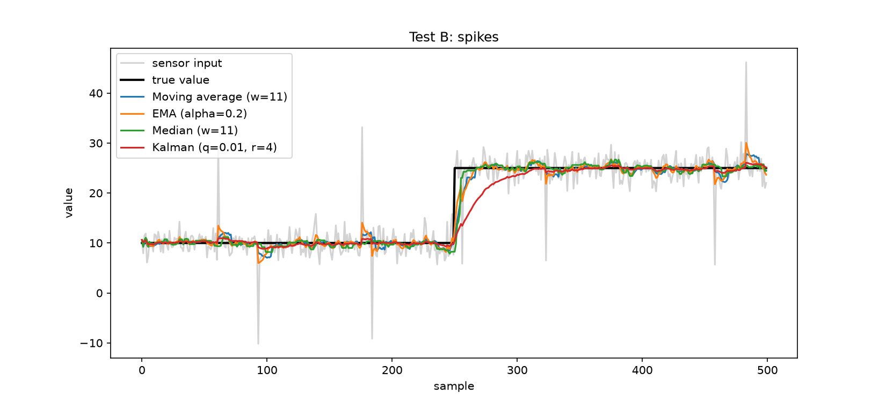
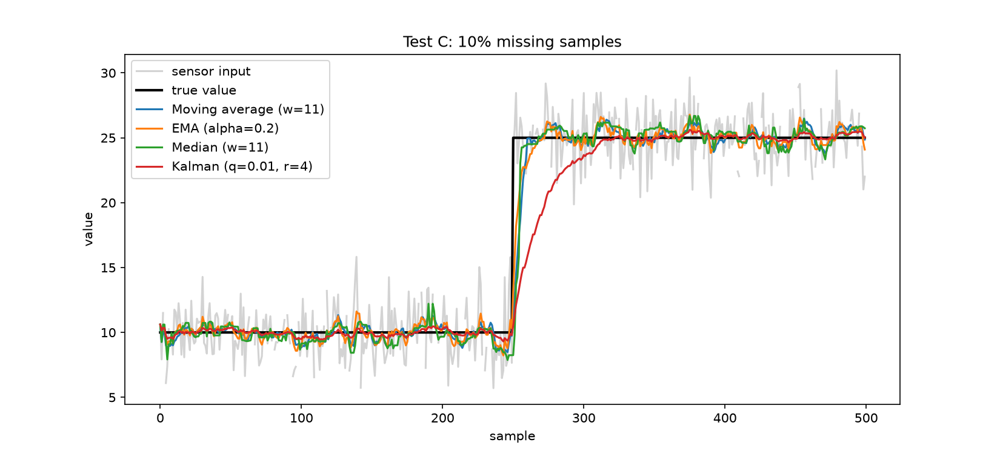
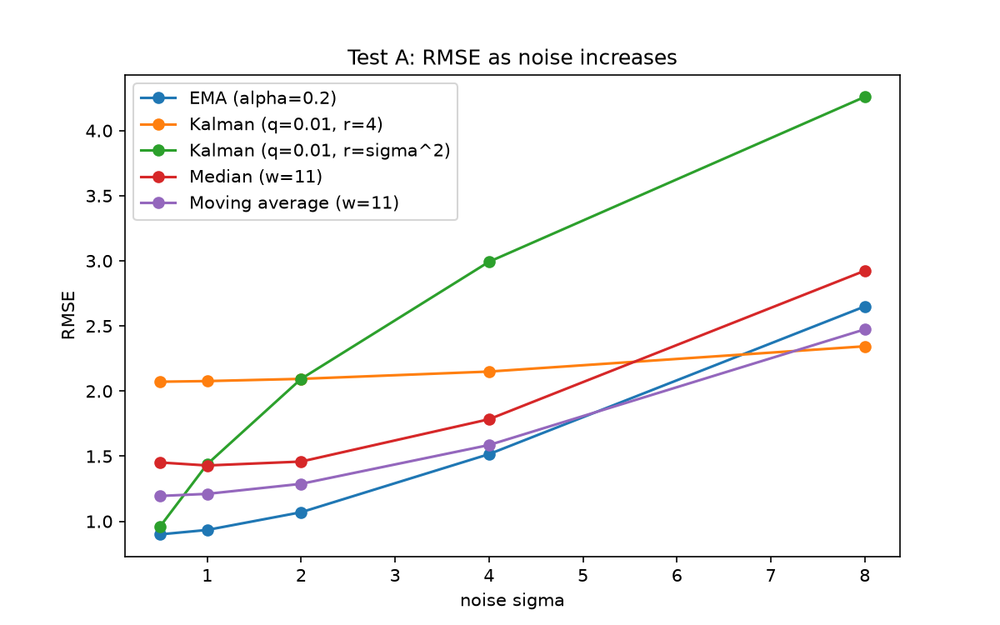
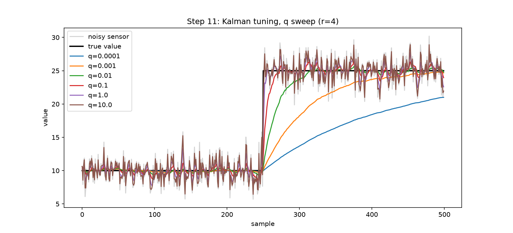
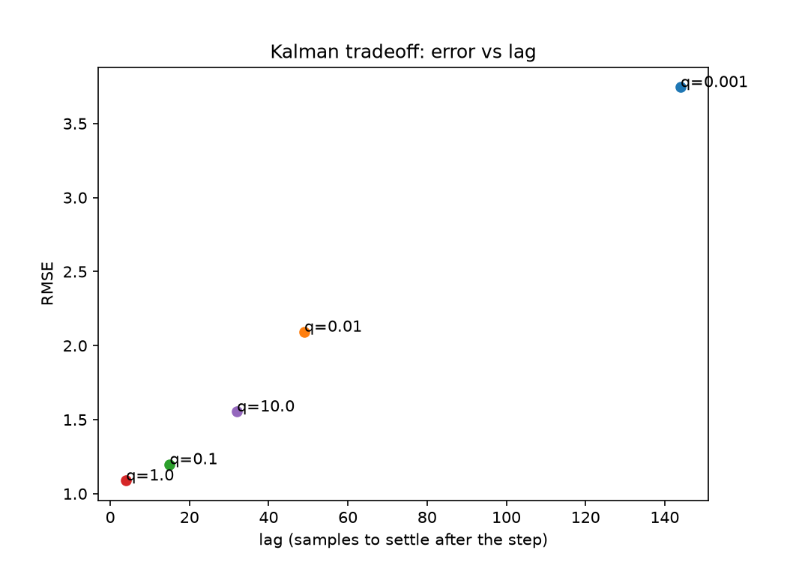
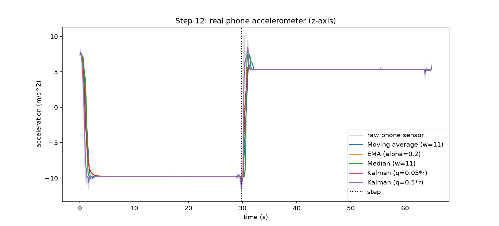

# Sensor Noise Filtering Lab

A small prototype comparing four filters (moving average, exponential moving average, median, and a 1D Kalman filter) on noisy sensor data. Every filter trades smoothness against delay, so the question is how much, and where each one breaks.

## Problem

Real sensors are noisy, and robots, drones and phones need a clean estimate of what is actually happening. Which filter gives the best balance between error and lag, and how does each one cope with extra noise, spikes and missing samples?

## Method

- Simulated signal: a flat value of 10 that jumps to 25 at sample 250 (a step), with Gaussian noise (sigma = 2, fixed random seeds so results can be reproduced).
- Filters, all written from scratch with numpy: moving average (w=11), EMA (alpha=0.2), median (w=11), Kalman (q=0.01, r=4, where r is the noise variance sigma squared).
- Metrics: RMSE against the true signal (typical error), and lag (samples after the step until the output stays within 10% of the step size for 10 samples in a row).
- Stress tests: noise sigma from 0.5 to 8, 2% spikes of size 20, and 10% missing samples.
- Tuning: a sweep of the Kalman q value, plus a check that only the ratio q/r matters.
- Real-data check: a phone accelerometer recording (z-axis) resampled to 10 Hz. There is no ground truth, so no RMSE is reported for it.

## Results

| condition | filter | RMSE | lag (samples) |
|---|---|---|---|
| noise only (sigma=2) | Moving average (w=11) | 1.288 | 10 |
| noise only (sigma=2) | EMA (alpha=0.2) | 1.07 | 11 |
| noise only (sigma=2) | Median (w=11) | 1.459 | 6 |
| noise only (sigma=2) | Kalman (q=0.01, r=4) | 2.094 | 49 |
| spikes (2%, size 20) | Moving average (w=11) | 1.523 | 17 |
| spikes (2%, size 20) | EMA (alpha=0.2) | 1.406 | 14 |
| spikes (2%, size 20) | Median (w=11) | 1.47 | 7 |
| spikes (2%, size 20) | Kalman (q=0.01, r=4) | 2.227 | 50 |
| 10% dropouts | Moving average (w=11) | 1.305 | 10 |
| 10% dropouts | EMA (alpha=0.2) | 1.063 | 12 |
| 10% dropouts | Median (w=11) | 1.467 | 6 |
| 10% dropouts | Kalman (q=0.01, r=4) | 2.15 | 50 |

Lag is the number of samples the filter needs to settle after the step. "did not settle" means it never stayed inside the band.

## Findings

- **Finding 1:** On the noise-only test (sigma=2), the EMA (alpha=0.2) had the lowest RMSE (1.07) and the Median (w=11) had the shortest lag (6 samples). No single filter won on both measures. A smoother filter averages over more past readings, so it removes more noise but takes longer to follow the step.
- **Finding 2:** With 2% spikes, the EMA (alpha=0.2) had the lowest RMSE (1.406) and the Kalman (q=0.01, r=4) the highest (2.227, up from 2.094 without spikes). Averaging filters (moving average, EMA, Kalman) are pulled toward each spike, while a median takes the middle value of its window and cannot be moved by one extreme reading.
- **Finding 3:** With 10% of samples missing, RMSE changed by at most 0.056 across the filters (largest change: Kalman (q=0.01, r=4), from 2.094 to 2.15). Each filter skips a missing reading and carries on from its previous estimate, or averages only the readings it has, so a gap costs very little.
- **Finding 4:** As q grew from 0.0001 to 10.0, the Kalman filter's RMSE went from 6.185 to 1.555 and its lag went from did not settle to 32 samples. A larger q tells the filter the true value changes a lot, so it trusts each new reading more: faster, but noisier. I chose q=1.0, the lowest RMSE (1.089) among the settings that settled (lag 4 samples).
- **Finding 5:** The phone accelerometer recording has no ground truth, so noise was measured as the standard deviation on a flat stretch. The raw sensor had a noise std of 0.0076; the quietest filter was Moving average (w=11) at 0.0027, and it settled in 1.6 s compared with 1.3 s for the raw signal. Less noise came with slower settling, the same tradeoff as in the simulation.

## Limitations

- The main data is simulated, and the signal has a single step, so it does not cover ramps, oscillations or drift.
- The 1D Kalman filter assumes the true value stays constant between samples, so it is a simplified version of what real systems use.
- One random seed was used for most runs, so small differences between filters may not be significant.
- The phone recording has no ground truth, is a single run, and was not recorded under controlled conditions.

## How to run

    pip install -r requirements.txt
    python3 main.py
    python3 step11_tune.py
    python3 step12_phone.py data/phone_accel.csv 3

Plots and tables are saved in the results folder.
